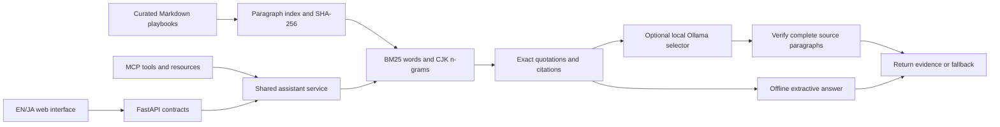

# Hikari — AI Operations Assistant

[日本語の説明](docs/README.ja.md)

A runnable bilingual portfolio project by Budi Juarto: a Python API and MCP server that retrieve operational evidence from fictional English and Japanese playbooks. Answers retain exact paragraphs, source line numbers and document hashes. An optional local Ollama model selects evidence; its output cannot add facts or change the selected quotation.

Built in October 2026 as a new portfolio demonstration. The playbooks describe a fictional service, Hikari Orders. They are not employer policies, past client work, or evidence of production deployment.

## Try it locally

Python 3.11 or newer is required. The default mode does not require an LLM, API key, GPU, or model download.

```powershell
python -m venv .venv
.venv\Scripts\python.exe -m pip install ".[test]"
.venv\Scripts\python.exe -m uvicorn ai_ops.api:app --host 127.0.0.1 --port 8000
```

On macOS/Linux, replace `.venv\Scripts\python.exe` with `.venv/bin/python`. Open <http://127.0.0.1:8000> for the UI and <http://127.0.0.1:8000/docs> for interactive API documentation.

Example English question: **When should we rollback a release?**

Example Japanese question: **重大障害のエスカレーションと復旧手順は？**

The language selector filters sources; it does not translate the question. A Japanese query should use Japanese sources, and an English query should use English sources. No result means the lexical retriever did not find sufficiently matching evidence; a result still requires a person to assess relevance.

## Architecture and decisions



* **Paragraph boundaries preserve conditions.** Each chunk is a complete paragraph under a Markdown section. Quotes are verified against original source lines. The rollback example retains the exception for irreversible migrations.
* **Lexical retrieval is a transparent baseline.** BM25, English stop words and normalized Japanese character n-grams run locally. This project does not use embeddings, a vector database, neural reranking, fine-tuning or automatic translation.
* **Evidence has provenance.** Every result includes file, section, lines, chunk ID, SHA-256, query coverage and retrieval score. The corpus version changes when document bytes change.
* **One implementation serves REST and MCP.** Pydantic contracts validate input; `OpsAssistant` supplies both interfaces. The MCP server uses the official `mcp==2.3.0` Python SDK, not a simulated tool-call format.
* **The optional model has a narrow job.** Ollama receives a question and retrieved excerpts, returning a constrained JSON selection. Unknown IDs, duplicate IDs, changed or truncated quotes, HTTP errors and invalid JSON fall back to original retrieved evidence. It never runs commands or approves operations.

## API

| Endpoint | Purpose |
| --- | --- |
| `GET /health` | Provider, corpus version, document and chunk counts |
| `GET /api/documents` | Allowlisted document catalog |
| `GET /api/documents/{document_id}` | Original document and digest |
| `POST /api/search` | Ranked source evidence |
| `POST /api/answer` | Exact excerpts, citations, mode and fallback warnings |

Search and answer requests use the same body:

```json
{"query":"When should we rollback a release?","language":"en","limit":3}
```

`query` accepts 2–500 meaningful characters without control characters. `language` is `en`, `ja` or `all`; `limit` is 1–5. Unknown fields and invalid inputs return HTTP 422. Document lookup accepts known IDs rather than arbitrary filesystem paths.

## MCP

Start the stdio server using the project's installed Python:

```powershell
.venv\Scripts\python.exe -m ai_ops.mcp_server
```

It waits for an MCP client on stdin/stdout. Use `ai_ops.demo` below to make an actual client connection rather than typing a question into the terminal.

Tools: `search_documents`, `answer_question`, `read_document`. Resources: `ops://catalog` and `ops://documents/{document_id}`. Tools are annotated as read-only and use allowlisted corpus documents. A generic host launch entry is:

```json
{
  "mcpServers": {
    "hikari-ops": {
      "command": "ABSOLUTE_PATH_TO_PROJECT/.venv/Scripts/python.exe",
      "args": ["-m", "ai_ops.mcp_server"],
      "env": {"AI_OPS_PROVIDER": "offline"}
    }
  }
}
```

Use an absolute executable path for your machine. No host configuration is edited automatically. The implementation follows the official [MCP server transport documentation](https://py.sdk.modelcontextprotocol.io/run/) and [Python SDK documentation](https://py.sdk.modelcontextprotocol.io/).

## Optional local Ollama

Use a model you have already installed in Ollama. Replace `YOUR_INSTALLED_MODEL` with its actual name, then restart the API/MCP process:

```powershell
$env:AI_OPS_PROVIDER = 'ollama'
$env:AI_OPS_OLLAMA_MODEL = 'YOUR_INSTALLED_MODEL'
$env:AI_OPS_OLLAMA_URL = 'http://127.0.0.1:11434'
.venv\Scripts\python.exe -m uvicorn ai_ops.api:app --host 127.0.0.1 --port 8000
```

The implementation uses Ollama's [chat endpoint with a JSON schema](https://docs.ollama.com/api/chat), a 25-second timeout and no redirects or proxy environment. Only plain HTTP loopback origins are accepted. Tests use a mocked Ollama transport; they validate the adapter and quote checks without proving any model's quality. No real local LLM was needed for the reproducible offline demo.

## Test and reproduce

```powershell
.venv\Scripts\python.exe -m pytest -q
.venv\Scripts\python.exe -m ai_ops.evaluate
.venv\Scripts\python.exe -m ai_ops.demo
```

The suite exercises source provenance, ranking, unknown-topic abstention, English/Japanese behavior, API validation, path restrictions, model tampering/failure handling, official SDK tools/resources and a real MCP stdio subprocess.

`ai_ops.evaluate` prints measured metrics for 20 positive and 6 negative hand-authored questions against the same six demo documents. It reports document Recall@1, section Recall@1/3, section MRR@3 and negative abstention. These are fixture regression measurements, not held-out accuracy or a production benchmark. The full fixture is versioned in `src/ai_ops/evaluation/cases.json`; recorded outputs are in [evidence](evidence/).

`ai_ops.demo` emits four offline answers plus a real MCP stdio answer, supported tool names and the negotiated protocol version. Both CLIs emit UTF-8 JSON on Windows.

The repository's [combined GitHub Actions workflow](../.github/workflows/portfolio.yml) runs the AI project on Windows/Linux, Python 3.11/3.13, with `ai-ops-assistant` as its working directory. Its CI result is only established after it runs on GitHub.

## Container

```powershell
docker compose up --build
```

The Compose file exposes only `127.0.0.1:8000`. The container runs as a non-root user, has a read-only filesystem, drops Linux capabilities, and uses offline mode. After trying it, run `docker compose down`. The Dockerfile and Compose settings are for a local demonstration; there is no user authentication, rate limiting, production monitoring or deployment guarantee.

## Scope and next work

This project demonstrates Python/FastAPI, typed API design, document ingestion, bilingual lexical retrieval, evidence grounding, local LLM integration, official MCP tools, regression evaluation and container packaging. It is suitable for explaining engineering decisions in an interview. It does not establish years of MCP, RAG or operational experience.

Useful next experiments: a held-out corpus and questions; Japanese morphological tokenization; a separately evaluated multilingual embedding baseline; access controls and per-document permissions before use with private business documents. Do not import private company documents into a public portfolio.
